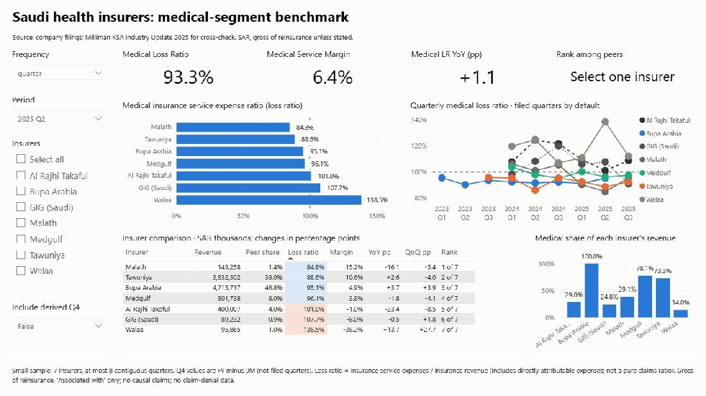

# Project B: KSA Health Insurer Performance Benchmark

**Status:** Core analysis complete (medical-segment panel, SQL, Power BI dashboard, report). Forecast not attempted (see 6) | **Data:** REAL (company filings; Milliman for cross-check)
**Target roles:** payer analytics, medical insurance, healthcare finance and strategy (KSA and UAE)

## 1. Business question

How do Saudi health-insurance carriers differ in **medical-segment** loss ratio and service margin, what is associated with the differences, and is the sector trend changing?
Only Bupa Arabia is mono-line medical. The other six (Tawuniya, Al Rajhi Takaful, GIG, Malath, Medgulf, Walaa) also write motor, property and other cover, so whole-company ratios are not a health benchmark. The panel is therefore **insurer x period x segment** (`medical`, `total`).

## 2. Results (all numbers produced by the code in `src/`; details in `reports/REPORT.md`)

Pooled 2024Q1 to 2025Q2, printed quarters only, gross of reinsurance:

| Insurer | Medical share of revenue | Medical loss ratio | 95% CI of quarterly mean (n=5) | Medical service margin | Whole-company loss ratio |
|---|---|---|---|---|---|
| Tawuniya | 72% | 91.5% | 86.4 to 96.7 | +7.7% | 83.5% |
| Bupa Arabia | 100% | 92.4% | 90.5 to 94.4 | +7.2% | 92.4% |
| Malath | 49% | 97.0% | 85.7 to 109.3 | +2.7% | 98.4% |
| Medgulf | 80% | 98.5% | 94.3 to 102.9 | +0.6% | 90.0% |
| GIG (Saudi) | 28% | 108.0% | 98.4 to 117.6 | -7.4% | 80.9% |
| Al Rajhi Takaful | 27% | 112.8% | 100.6 to 125.1 | -12.8% | 84.0% |
| Walaa | 18% | 119.4% | 104.7 to 135.6 | -19.3% | 58.4% |

Sector medical loss ratio (Milliman, ~21 companies): 96.6% (2022), 95.2% (2023), 96.2% (2024), 95.6% (2025).
"Loss ratio" here = insurance service expenses / insurance revenue. It includes directly attributable expenses, so it is not a pure claims ratio (`reports/RATIO_DEFINITIONS.md`).

## 3. Data

| Source | What | Notes |
|---|---|---|
| Company interim and annual financial statements (PDF) | Statement of income and the **operating-segment note** | 7 insurers, 30 filings 2024 to 2025 (comparative columns reach back to 2023); downloaded manually from the Saudi Exchange and company IR pages, which block scripted downloads |
| Milliman KSA Industry Update 2025 (`data/raw/6_4_26_KSA-Industry-update-2025.pdf`) | Whole-company tables for 24 insurers; sector medical table (p.15) | Cross-check only; company-level medical figures are charts, not tables |
| Tawuniya annual report 2024 | Reported ratios (p.41) | No audited statements inside; used for reference only |

IFRS 17 applies from 2023. All panel periods are 2023 or later, so every row is `post_ifrs17 = True`; pre-2023 comparatives were not extracted and the transition is not observed.
Every value traces to a file and page: `reports/sources.csv` (per file), `data/clean/segment_long.csv` and `statements_long.csv` (per value).

## 4. Setup and run (PowerShell)

```powershell
cd projects\b-ksa-insurer-benchmark
python -m venv .venv
.\.venv\Scripts\Activate.ps1
pip install -r requirements.txt
.\run_all.ps1                  # rebuilds every output from data\raw and runs the tests
```

PDFs must be in `data/raw/` named `insurer_PERIOD.pdf` (for example `malath_2025Q2.pdf`, `walaa_2025FY.pdf`). `run_all.ps1` runs these steps in order, and each can also be run alone:
`src.income_statement` (statements), `src.milliman`, `src.clean` (whole-company panel), `src.segments` (segment notes), `src.panel` (medical/total panel, derived Q4),
`src.crosscheck`, `src.build_db` (DuckDB + SQL views), `src.analysis`, `src.figures`, `src.export_powerbi`, `src.definitions`, `src.audit`, then `pytest`.
The first run reads scanned pages with OCR (about a minute per page); later runs use the cache. A full rebuild was re-run and reproduced `panel_segment.csv` and `statements_long.csv` identically.

Walkthrough: `notebooks/01_walkthrough.ipynb` (reads the finished data; needs no PDFs). Column definitions: `data/clean/DATA_DICTIONARY.md`.

Scanned statement pages are read by OCR (`src/ocr.py`, RapidOCR; cached in `data/interim/ocr/`) and are only trusted because of the checks in section 7.

## 5. Folder structure

```
data/raw/        downloaded PDFs (never edited; two duplicates / non-financial files are ignored)
data/raw_uae/    UAE filings downloaded only to screen for a medical segment (none used)
data/clean/      statements_long, segments_raw, segment_long, panel, panel_segment, milliman_long, insurers.duckdb,
                 DATA_DICTIONARY.md
notebooks/       01_walkthrough.ipynb (executed; reads the clean data)
run_all.ps1      one-command rebuild + tests
src/             income_statement, segments, panel, clean, ratios, ocr, milliman, crosscheck, analysis, audit,
                 build_db, export_powerbi, figures, definitions
sql/             01_medical_ratios, 02_market_share, 03_changes, 04_peer_rank (DuckDB views)
tests/           38+ tests: parsing, reconciliations, panel definitions, SQL vs pandas
reports/         REPORT.md, RATIO_DEFINITIONS.md, sources.csv, milliman_crosscheck.csv, audit_*.csv,
                 tables/, figures/, powerbi/ (star schema CSVs, MEASURES.md, dashboard/ PBIP project,
                 ksa_insurer_benchmark.pbix)
```

## 6. Scope (what was done, what was cut)

Done: medical-segment extraction for all 7 insurers; panel by segment; ratio definitions checked under IFRS 17; Milliman cross-check; DuckDB + SQL views; Power BI star schema and DAX; peer comparison with intervals; trends; rolling volatility; report.
Cut on purpose (fewer than 10 insurers, few years): panel regression with fixed effects, Chow / structural-break test, hierarchical clustering.
**Forecast not run.** The rule was at least 8 quarterly points per insurer; Tawuniya has 7 with a longest contiguous run of 3 (it has no full-year filings, so no derived Q4). The other six have 8 to 10.

### Power BI dashboard

One page, "Medical insurer benchmark" (slicers for frequency, period, insurer and "Include derived Q4"; KPI cards; medical loss ratio by insurer; quarterly trend; comparison table; medical share of revenue; tooltip page).
Open `reports/powerbi/dashboard/ksa_insurer_benchmark.pbip` (Power BI Project) or `reports/powerbi/ksa_insurer_benchmark.pbix`. If the CSVs move, change the `DataFolder` parameter (Transform data > Edit parameters) and refresh. Model and DAX: `reports/powerbi/MEASURES.md`; test results: `reports/powerbi/dashboard/ACCEPTANCE.md` and `REVIEW_FIXES.md`; screenshot: `reports/powerbi/dashboard/desktop-verification.jpg`.



Verification: the DAX results saved from Desktop match the project's SQL views exactly for all 7 insurers (loss ratio, revenue, margin, YoY, QoQ, rank), the pooled KPI is a ratio of sums (2025 Q2: 93.3% pooled vs 101.7% unweighted mean), and blanks stay blank (for example Tawuniya has no FY rows and Medgulf has no combined ratio).
Not verified: the tooltip hover behaviour (no hover action was available when the report was built) and exact dash-pattern rendering of the reference lines. Check these by hand in Desktop.
The rank card reads "Select one insurer" until one insurer is chosen, because with several insurers the card holds a pooled ratio that cannot be ranked.

## 7. Data quality and the error rate

* **Random 10% audit** (seed 42): 52 of 523 extracted values (24 consolidated, 28 segment) checked against the PDFs: **0 errors; 95% upper bound on the error rate 6.9%**. 38 were matched automatically in the page text layer; 14 (13 OCR plus 1 digit-split text layer) were verified by eye against rendered pages. Detail: `reports/audit_results.csv`.
* **Reconciliations in `tests/`:** revenue minus service expenses plus net reinsurance equals the reported subtotal on every filing and the panel; segment columns sum to the printed total; segment totals equal the consolidated statements (57 periods); calculated and printed medical service result agree on 118 rows; quarters sum to the nine-month figure (Tawuniya claims excepted, see below); all 24 full-year revenue and net-income values equal Milliman's.
* **Milliman cross-check** (`reports/milliman_crosscheck.csv`): FY2024, our six insurers = 59.5% of sector medical revenue; loss ratio 97.0% vs sector 96.2% (rest of sector implied 94.9%); ranking by 2025 medical revenue matches Milliman's chart order (7 of 7).

## 8. Not extracted or not available

* Bupa 2025Q3/Q4 and FY2025; Tawuniya FY filings (so no Q4) and anything before 2023Q3; pre-2023 (IFRS 4) data for all insurers.
* Medgulf prints no "other operating expenses" line, so no whole-company expense or combined ratio for it.
* Medical expense and combined ratios (no insurer allocates other operating expenses to segments).
* Q4 values are derived as FY minus 9M and flagged `is_derived`.
* Tawuniya's three-month claims columns sum 0.5% to 1% below its nine-month figure in both years (an inconsistency in the filings).
* **UAE (stretch goal): screened, none added.** The filings are publicly downloadable from the DFM disclosure feed (`feeds.dfm.ae`), but none of the three insurers checked publishes a medical-only segment: Dubai Insurance reports "Life and Medical" as one segment (33.0% of FY2025 insurance revenue; Integrated Report p.41), Sukoon reports "general insurance including medical", and AMAN reports investments vs underwriting of all takaful classes. Under the no-estimate rule they stay whole-company only and are not in the medical panel. Evidence and page references: `reports/uae_screen.csv`; files under `data/raw_uae/` (kept out of the KSA pipeline). Daman, NAS, Nextcare and other UAE insurers (for example Orient and Dubai National) were not screened.

## 9. Limitations

- Few insurers and periods, so statistical power is low; intervals use n = 5 quarters and ignore autocorrelation.
- IFRS 17 changes presentation; the 2022 to 2023 break is outside the data.
- Financial statements do not show claim denials or provider-level data.
- Ratios are gross of reinsurance.

## 10. Do not claim

- Causal explanations for loss-ratio changes (say "associated with").
- Anything about claim denial rates.

## 11. Resume line

> Built a medical-segment benchmark of 7 Saudi health insurers (30 filings, 2023 to 2025) by extracting operating-segment notes (OCR for scanned statements; 52-value audit with 0 errors); showed medical loss ratios of 92% to 119% re-rank insurers against whole-company figures (58% to 98%); reconciled to Milliman sector data; delivered DuckDB SQL views and a Power BI model.
