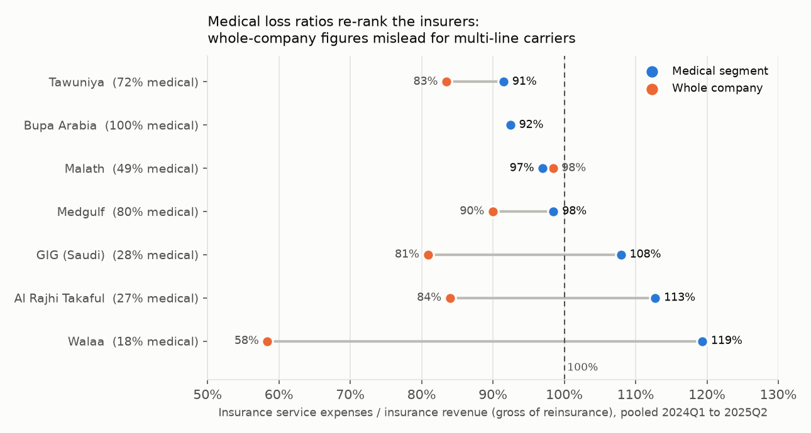
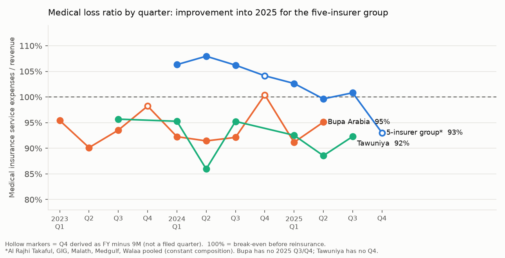

# KSA health insurers: medical-segment benchmark

**Small sample, stated up front.** 7 Saudi insurers, 2023 to 2025, 8 to 10 quarterly points each (Tawuniya 7, with gaps). Confidence intervals use n = 5 quarters and are indicative only. All figures are SAR, gross of reinsurance unless stated, from company filings (page references in `reports/sources.csv`); Milliman is used only as a cross-check.

## Findings

1. **Whole-company loss ratios are not a health-insurance benchmark.** Only Bupa Arabia is mono-line medical (stated in its segment note). For the other six, medical is 18% to 80% of revenue. On the medical segment alone (pooled 2024Q1 to 2025Q2) the order is Tawuniya 91.5%, Bupa 92.4%, Malath 97.0%, Medgulf 98.5%, GIG 108.0%, Al Rajhi Takaful 112.8%, Walaa 119.4%. On whole-company figures the same insurers rank almost the other way round: Walaa looks best (58%) and Bupa second-worst (92%). The rank correlation between the two views is -0.54 (n = 7, p = 0.22, not significant). A lower medical share is associated with a higher medical loss ratio (Spearman -0.82, p = 0.02, n = 7); this does not show why.

2. **Medical margins are thin or negative outside Tawuniya and Bupa.** Pooled medical service margin (insurance service result / revenue): Tawuniya +7.7%, Bupa +7.2%, Malath +2.7%, Medgulf +0.6%, GIG -7.4%, Al Rajhi Takaful -12.8%, Walaa -19.3%. Milliman's sector-wide medical margin is 3.4% (2024) and 4.0% (2025).

3. **Sector trend (Milliman, ~21 companies):** the medical loss ratio was 96.6% (2022), 95.2% (2023), 96.2% (2024) and 95.6% (2025); margin 2.7%, 4.6%, 3.4%, 4.0%. That is a small improvement in 2025, not a break from 2023. Our own constant group (Al Rajhi, GIG, Malath, Medgulf, Walaa) improved from 106.8% to 101.0% pooled over Q1 to Q3 (-5.8 pp) and its margin from -7.5% to -1.1%, but it holds only 13.8% of sector medical revenue in FY2025 (Bupa and Tawuniya are absent), so it should not be read as the sector. Within it, Malath (-14.1 pp), Al Rajhi (-12.3 pp) and GIG (-6.5 pp) improved, Medgulf was flat (-0.9 pp) and Walaa worsened (+2.6 pp). Tawuniya (92.3% to 91.1%) and Bupa (H1 91.8% to 93.2%) were broadly stable. Derived Q4 values are shown in figure 2 but excluded from these statements.

## Three insurer comparisons

* **Bupa vs Tawuniya** (the two large, medical-heavy carriers): 92.4% vs 91.5% pooled. The 95% intervals overlap heavily (Bupa 90.5 to 94.4; Tawuniya 86.4 to 96.7), so the data do not separate them. Bupa's four-quarter volatility averages 3.7 pp; Tawuniya has too few contiguous quarters to compute one.
* **Medgulf vs Malath** (both near break-even): Medgulf 98.5% (interval 94.3 to 102.9, 80% medical, volatility 2.9 pp) vs Malath 97.0% (interval 85.7 to 109.3, 49% medical, volatility 6.6 pp). Similar levels, but Malath's quarterly path is much less stable.
* **Walaa vs Al Rajhi Takaful** (highest medical loss ratios): 119.4% and 112.8%, intervals entirely above 100% (104.7 to 135.6; 100.6 to 125.1). Medical is a small part of both (18% and 27% of revenue), and Walaa's four-quarter volatility averages 17.9 pp, the highest in the set. Their whole-company ratios (58% and 84%) hide this.

## What the segment split changed

| Insurer | Medical share | Whole-company loss ratio (rank) | Medical loss ratio (rank) |
|---|---|---|---|
| Tawuniya | 72% | 83.5% (3) | 91.5% (1) |
| Bupa Arabia | 100% | 92.4% (6) | 92.4% (2) |
| Malath | 49% | 98.4% (7) | 97.0% (3) |
| Medgulf | 80% | 90.0% (5) | 98.5% (4) |
| GIG (Saudi) | 28% | 80.9% (2) | 108.0% (5) |
| Al Rajhi Takaful | 27% | 84.0% (4) | 112.8% (6) |
| Walaa | 18% | 58.4% (1) | 119.4% (7) |

Rank 1 = lowest ratio. Medical ratios run 8 to 61 pp above whole-company ratios for five insurers; only Malath is lower (-1.4 pp). Property and casualty books are heavily reinsured, so their *gross* service expenses are small and pull multi-line whole-company ratios down.

## Definitions and checks

* **Loss ratio = insurance service expenses / insurance revenue.** Under IFRS 17 that line holds incurred claims *and* other directly attributable expenses, so it is not a pure claims ratio. Bupa's roughly 2% "expense ratio" (1.9% of revenue) is only *other operating expenses*; its acquisition-cost amortisation (5.0% of revenue, FY2024 note p.66) already sits inside the loss-ratio numerator. Expense and combined ratios exist only at whole-company level because no insurer allocates other operating expenses to segments, and Medgulf prints no such line. See `RATIO_DEFINITIONS.md`.
* **Milliman cross-check** (`milliman_crosscheck.csv`): all 24 full-year revenue and net-income values match Milliman's whole-company tables exactly. For FY2024 our six insurers cover 59.5% of Milliman's sector medical revenue with a loss ratio of 97.0% against the sector's 96.2% (the rest of the sector implied at 94.9%) and a margin of 2.5% against 3.4%; the gap is consistent with our set including higher-ratio carriers. Ranking our seven insurers by 2025 medical revenue reproduces the order of Milliman's chart labels (7 of 7). FY2025 coverage is only 13.8%, so that comparison is weak.
* **Data audit:** a seeded 10% sample (52 of 523 values) was checked against the PDFs: 0 errors (95% upper bound on the error rate 6.9%). Thirteen values on scanned pages were read by OCR and verified by eye against the page images. Segment columns sum to the printed totals, and segment totals equal the consolidated statements on all 57 comparable periods.

## Forecast

Not attempted. The README rule needs at least 8 quarterly points per insurer, and Tawuniya (no full-year filings, so no derived Q4) has 7 with a longest contiguous run of 3. Peer comparison, trends and rolling volatility are reported instead.

## Limitations

* Seven insurers and at most 8 contiguous quarters: low power, no panel regression, structural-break test or clustering. Data start in 2023, so the IFRS 17 transition (2022 to 2023) is not observed.
* 2023Q4, 2024Q4 and 2025Q4 are derived (FY minus 9M) and absorb any year-end adjustments; the rolling four-quarter volatility windows include them. Bupa has no 2025 Q3 or Q4 and Tawuniya has no Q4.
* Tawuniya's three-month claims columns sum 0.5% to 1% below its reported nine-month figure in both years (an inconsistency in the filings).
* Medical segments are each insurer's own definition (Tawuniya includes compulsory medical business; Al Rajhi labels it Medical/Health; GIG "Health"). Ratios are gross of reinsurance, which flatters heavily reinsured books.
* Differences are described as "associated with"; nothing here is causal. Financial statements contain no claim-denial or provider-level data, so nothing is said about either.
